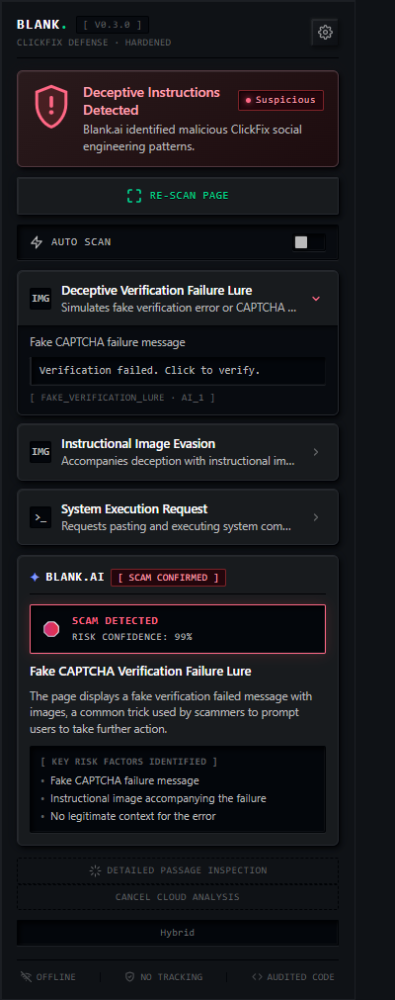
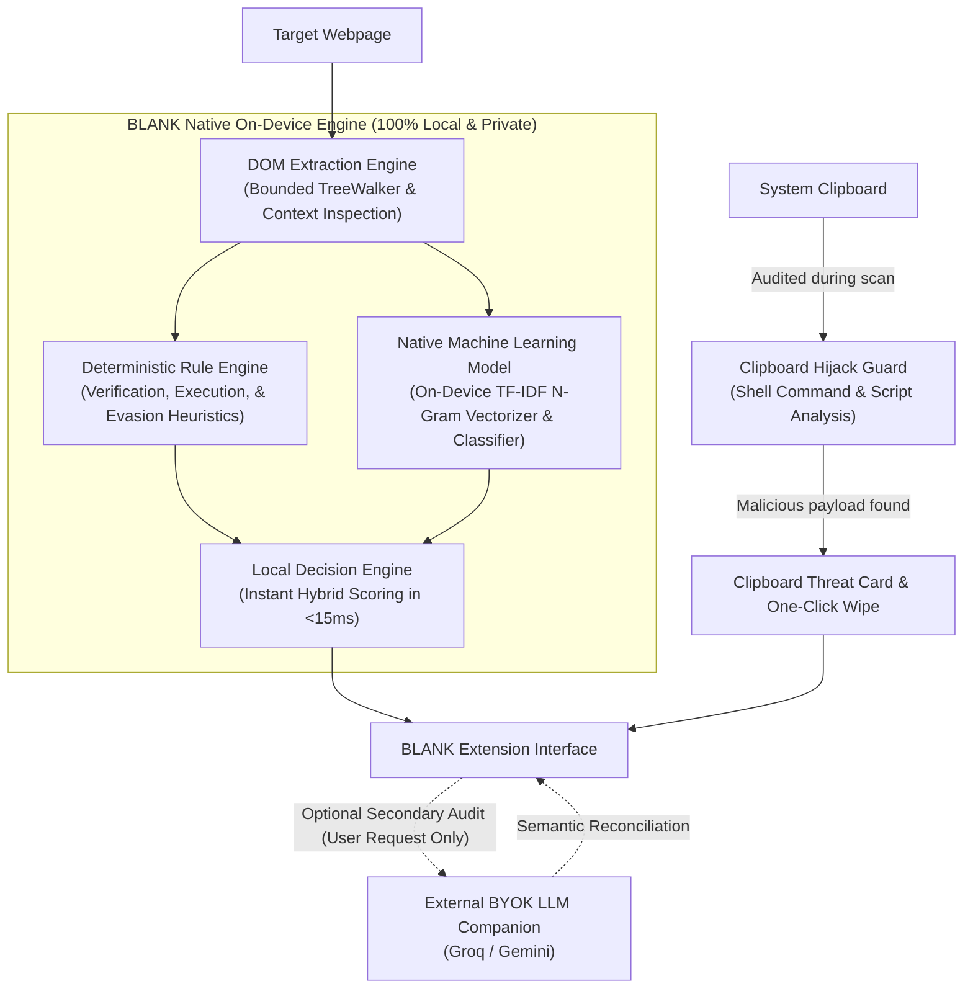

# BLANK. · ClickFix Defense

<p align="center">
  
</p>

<p align="center">
  <strong>Context-aware, on-device AI defense against deceptive copy-and-run web instructions.</strong><br>
  Self-contained Chromium Manifest V3 extension powered by native on-device machine learning and heuristic intelligence. Neutralizes ClickFix social engineering and clipboard hijacking with zero cloud latency and 100% local privacy.
</p>

<p align="center">
  
  
  
  
  
  
  
  
  
</p>

---

## Overview

**BLANK** is a privacy-first browser extension engineered to detect and neutralize **ClickFix** attacks. ClickFix is a widespread cyber deception technique where compromised or malicious sites present fake CAPTCHAs, robot verification errors, or browser repair guides that trick users into opening a system terminal (Windows Run `Win + R`, PowerShell, or Cmd) and pasting dangerous commands.

### Powered by Native On-Device AI/ML

Unlike extensions that merely forward your web browsing data to external APIs, **BLANK runs its own custom-trained machine learning model directly inside your browser**:

1. **Embedded Neural & Statistical Classifier:** Bundled directly into the extension (`model.json` + `detector.js`), running locally on your CPU via optimized JavaScript vectorization with zero network latency.
2. **TF-IDF & N-Gram Intent Analysis:** Evaluates instruction semantics, terminology, and syntactic structure against specialized ClickFix attack corpora to score malicious intent in under 15 milliseconds.
3. **Deterministic Multi-Stage Heuristics:** Interlocks with calibrated rule engines to detect image-based evasion, fake CAPTCHA failure modals, and PowerShell execution traps simultaneously.
4. **Complete Local Privacy:** Not a single word of the pages you visit or the commands analyzed ever leaves your machine.

---

## Key Features

### 🧠 Native On-Device Machine Learning Engine
- **Local Browser Inference:** Runs entirely inside the extension background service worker without requiring an internet connection or external servers.
- **Trained on Attack & Benign Datasets:** Uses n-gram tokenization and logistic regression weights optimized specifically to separate deceptive verification lures from real administrative tutorials.
- **Zero Latency & Always Available:** Delivers instant (<15ms) verdicts as soon as a page is scanned.

### 🛡️ Multi-Vector Social Engineering Defense
- **Execution Sequence Traps:** Detects combinations of Windows Run prompts (`Win + R`), command shells (`powershell`, `cmd`), paste triggers, and execution shortcuts.
- **Instructional Image Evasion:** Catches evasion attacks where attackers place malicious instructions inside images or overlays to bypass basic keyword scanners.
- **Contextual Disambiguation:** Intelligently recognizes educational websites, search engine results, and security news articles to avoid false alarms.

### 📋 Silent Clipboard Hijack Isolation & Buffer Wipe
- **Automatic Clipboard Audit:** Detects when malicious websites silently copy obfuscated shell commands or scripts into your system clipboard without your knowledge.
- **Sandbox Readout:** Displays the intercepted clipboard content in a sanitized inspection well.
- **Instant Buffer Wipe:** Purges the operating system clipboard buffer with a single click before you can accidentally paste it.

### ✦ Optional Secondary Cloud AI Companion (BYOK)
- **Optional Second Opinion:** For users who want supplementary deep-reasoning verification, BLANK optionally supports user-provided Bring-Your-Own-Key (BYOK) Groq or Google Gemini connections.
- **Strictly User-Controlled:** Never runs automatically unless explicitly configured and requested.
- **Ephemeral Session Security:** Cloud keys reside only in temporary memory (`chrome.storage.session`) and are instantly forgotten when the browser closes.

---

## Architecture & Detection Pipeline



---

## Privacy & Security Guarantees

| Principle | Guarantee |
| :--- | :--- |
| **100% On-Device AI** | All primary machine learning classification, rule evaluation, and clipboard audits happen locally on your computer. |
| **Zero Remote Telemetry** | Page text, URLs, browsing history, and classifier outputs are **never** transmitted to any analytics or tracking server. |
| **No Mandatory Cloud** | BLANK requires no accounts, no subscriptions, and zero outbound network calls to function. |
| **Ephemeral Key Storage** | Optional BYOK API keys reside solely in `chrome.storage.session` and are purged automatically when the browser session terminates. |
| **Safe DOM APIs** | All evidence strings and page-derived text are rendered using strict text nodes (`.textContent`) and sandboxed elements. |
| **Minimal Permissions** | Uses standard Chrome Manifest V3 APIs (`activeTab`, `scripting`, `storage`, `offscreen`, `clipboardRead`). No mandatory host permissions. |

---

## Installation & Usage

> [!NOTE]
> **Chromium Browsers Only:** BLANK is designed specifically for Chromium-based browsers (Google Chrome, Microsoft Edge, Brave, Opera, Vivaldi, Arc, etc.) utilizing the modern Chrome Manifest V3 service worker and Offscreen Document APIs. Firefox and Safari are not currently supported.

### 1. Load Unpacked (Chrome / Edge / Brave / Opera / Arc)
1. Clone this repository (or download `blank-0.3.0.zip` from [Releases](https://github.com/athx1337/blank-clickfix-detector/releases)):
   ```bash
   git clone https://github.com/your-username/blank.git
   cd blank
   ```
2. Open your browser's extension management page:
   - **Chrome / Brave:** `chrome://extensions`
   - **Microsoft Edge:** `edge://extensions`
3. Toggle on **Developer mode** in the upper-right corner.
4. Click **Load unpacked** and select the [`extension/`](extension/) directory from this repository.
5. Pin **BLANK** to your browser toolbar.

### 2. Scanning Webpages
1. Navigate to any web page.
2. Click the BLANK icon on your browser toolbar.
3. Click **SCAN THIS PAGE** (`RE-SCAN PAGE`).
4. To enable background checks on trusted domains, toggle **AUTO SCAN** (requests site access on-demand).

### 3. (Optional) Supplementary Cloud AI (BYOK)
1. If you wish to enable optional cloud second-opinion audits, click the gear icon (**Settings**).
2. Under **Cloud LLM Verification (BYOK)**, select your provider (**Groq** or **Google Gemini**).
3. Paste your API key and click **Connect API Key**.
4. The key is stored ephemerally in session memory and can be removed at any time.

---

## Developer & Research Workflow

### Prerequisites
- **Python:** 3.12+ / 3.14+
- **Node.js:** 18+

### Setup Virtual Environment
```powershell
# 1. Create and activate virtual environment
py -3.14 -m venv .venv
.\.venv\Scripts\Activate.ps1

# 2. Install locked dependencies
pip install -r requirements-dev.lock.txt

# 3. Install Playwright browser binaries
playwright install chromium
```

### Automated Testing & Quality Gates
```powershell
# Run all unit tests with code coverage (Target: 70%+)
python -m pytest --cov=backend --cov=ml

# Run Playwright real browser extension integration tests
python -m pytest -m browser tests/test_browser.py

# Run Node API contract tests
node --test tests/*.test.cjs

# Run Python code linter (Ruff)
python -m ruff check backend ml data tests tools

# Verify all extension JavaScript files syntax
Get-ChildItem extension -Filter "*.js" | ForEach-Object { node --check $_.FullName }
```

### Model Training & Browser Export
```powershell
# Train the TF-IDF / logistic regression classifier
python -m ml.train --data data/seed.jsonl

# Evaluate classifier against held-out splits
python -m ml.evaluate --data data/seed.jsonl

# Export weights and rules to extension assets
python -m ml.export_browser
```

### Packaging for Release
```powershell
# Builds release ZIP into dist/blank-0.3.0.zip
python tools/package_extension.py

# Verify package integrity against allowlist
python -m pytest tests/test_package.py
```

---

## Project Structure

```
├── .agents/                 # Project verification and testing skills
├── backend/                 # Reference Python API & feature extraction tooling
│   ├── app.py               # Reference FastAPI server
│   ├── detector.py          # Unified rules + ML analysis engine
│   ├── features.py          # Normalized tokenizers and keyword extraction
│   └── rules.py             # Heuristic rule definitions
├── data/                    # Dataset seeds and review queues
│   ├── seed.jsonl           # Synthetic training & evaluation seed
│   └── build_seed.py        # Seed dataset builder
├── docs/                    # Architecture, privacy, and evaluation reports
│   └── design/              # UI screenshots and visual assets
├── extension/               # Shipped Manifest V3 Chrome/Edge extension
│   ├── manifest.json        # MV3 manifest definition
│   ├── background.js        # Service worker & scan orchestration
│   ├── content.js           # DOM extraction & in-page warning banner
│   ├── detector.js          # On-device JavaScript rules & linear model
│   ├── popup.html / .js     # Extension popup user interface
│   ├── popup.css            # Dark tactical styling
│   ├── cloud.js             # Optional BYOK Groq & Gemini client
│   └── assets/              # Bundled on-device model.json and rules.json
├── ml/                      # Machine learning training and evaluation pipeline
├── tests/                   # Comprehensive test suite (unit, browser, integration)
└── tools/                   # Packaging and icon generation scripts
```

---

## Documentation Links

- [Technical Architecture](docs/architecture.md)
- [Privacy Policy & Data Principles](docs/privacy.md)
- [Manual Testing Guide](docs/manual-testing.md)
- [Evaluation & Research Limits](docs/evaluation.md)
- [Third-Party Notices & Upstream Ledger](docs/third-party.md)
- [Release Gates & Verification Protocol](docs/release.md)

---

## Upstream Reuse & Licenses

BLANK is released under the **MIT License**.

This project incorporates heuristics and insights from research into the ClickFix attack vector:
- **ClickFixMitigator** (MIT License) — Upstream heuristics reference.
- **ClickGrab** (Apache 2.0 License) — Rule and dataset extraction references.
- See [`extension/THIRD_PARTY_NOTICES.txt`](extension/THIRD_PARTY_NOTICES.txt) and [`licenses/`](licenses/) for full text.
